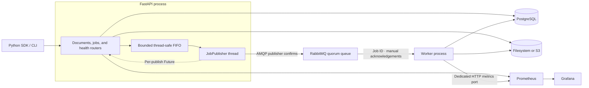

# Pulse

Upload a document, get a job ID, and let a separate worker analyze the text. Pulse combines a FastAPI service, a RabbitMQ quorum queue, and a Python worker with PostgreSQL as the shared record of documents, jobs, and results.



## Inside the queue

1. **Register.** The [FastAPI service](server/api/main.py) starts and stops the publisher with the application lifespan. Its documents router stores the uploaded bytes and registers the document and job. The jobs router exposes processing status, and the health router serves liveness and Prometheus metrics.
2. **Publish.** [JobPublisher](server/api/messaging/jobpublisher.py) owns its AMQP connection and channel on a dedicated thread. It drains a bounded, thread-safe FIFO and publishes one job ID at a time. The thread reuses its channel across requests, saving the round trips associated with opening a channel for every publish. [RabbitMQ channel lifecycle guidance](https://www.rabbitmq.com/docs/channels#channel-lifecycle)
3. **Confirm.** Each queued publish has its own Python `Future`. The upload handler waits for that future before returning the document and job IDs. RabbitMQ publisher confirms let the thread resolve the future on broker acceptance or report a publish failure to the waiting handler. The jobs endpoint tracks the worker's processing outcome.
4. **Process.** The [worker](server/api/worker/main.py) runs in its own process and consumes with a prefetch of one. It marks the job as processing, reads the document, computes text statistics, and commits the analysis and completed status to PostgreSQL before acknowledging the message. On a processing exception, it records the failure and negatively acknowledges the delivery without requeuing it.

## Run locally

With Docker and Compose installed, start PostgreSQL, RabbitMQ, the migration service, the API, and the worker from the repository root.

```bash
docker compose -f server/compose.yaml up --build -d
curl --fail http://localhost:8000/health/live
curl --fail -F 'file=@README.md' http://localhost:8000/documents
```

The upload returns a `document_id` and a `job_id`. Use [Swagger UI](http://localhost:8000/docs) to look up the document and job under their respective routers. The [Python SDK and CLI](packages/client/) wrap these endpoints.

## Build, release, and deploy

| Component | What it does |
| --- | --- |
| [Server Dockerfile](server/dockerfile) | Builds one runtime image for the API, worker, and migration commands. |
| [SDK Dockerfile](packages/dockerfile) | Builds a Python wheel and source distribution in a separate image. |
| [GitHub Actions](.github/workflows/) | Lints pull requests, lints and builds on pushes to `main`, publishes the server image to GHCR on `server-v*` releases, and attaches validated SDK distributions to `sdk-v*` releases. |
| [Helm chart](helm/pulse/) | Deploys the API and worker, provisions PostgreSQL and RabbitMQ, runs Alembic through a migration Job, and supports filesystem or S3 document storage. |

The chart includes optional [Prometheus PodMonitors](helm/pulse/templates/podmonitors.yaml) and a [Grafana processing dashboard](helm/pulse/dashboards/pulse-processing.json) for existing monitoring installations. The API exposes metrics through FastAPI. The worker starts a small [HTTP metrics server](server/api/worker/metrics.py) on its own thread and dedicated port so Prometheus can scrape it while the worker consumes jobs.
