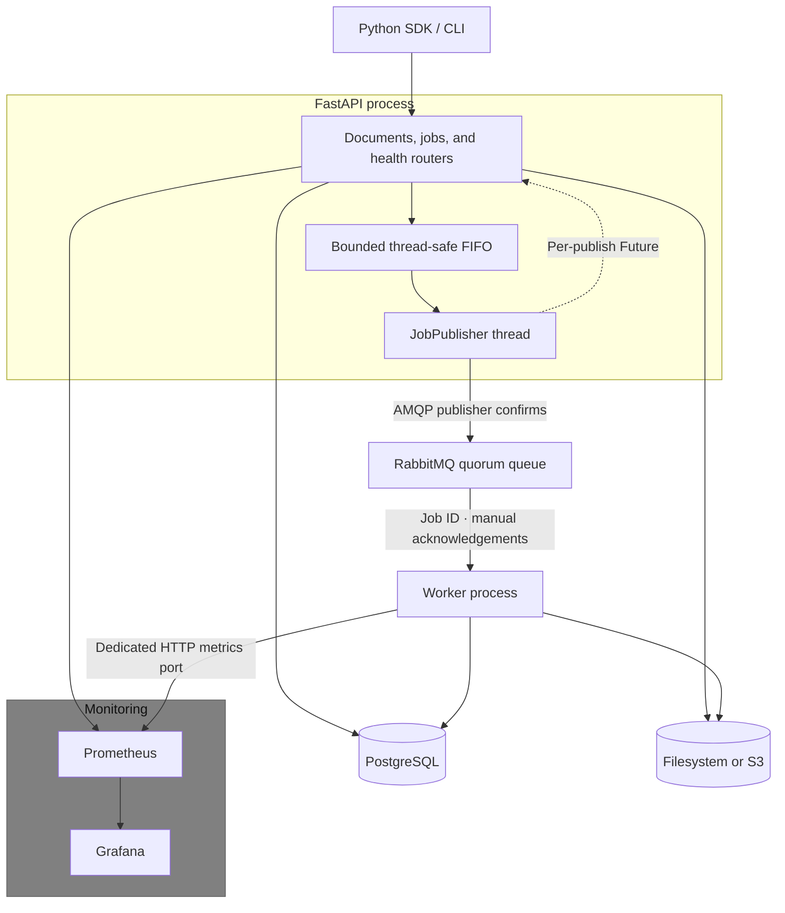

# Pulse

Upload a document, get a job ID, and let a separate worker analyze the text. Pulse combines a FastAPI service, a RabbitMQ quorum queue, and a Python worker with PostgreSQL as the shared record of documents, jobs, and results.

## Inside Pulse

1. ***Documents/Jobs service.*** [FastAPI service](server/api/api/documents.py) Classic Http methods that enable uploading a document and getting a job information/status. The service lifespan starts and stops another thread which manages communication with the broker.
3. ***Publish.*** a dedicated [JobPublisher](server/api/messaging/jobpublisher.py) class that maintains broker communication channel open, loads new jobs into a thread safe queue which in turn hands messages to the broker.
4. ***Worker.*** [A separate process/application](server/api/worker/main.py)  that marks the job as processing, reads the document, computes text statistics, and commits the analysis and completed status to PostgreSQL before acknowledging the message. On a processing exception, it records the failure and negatively acknowledges the delivery without requeuing it.
5. ***Relational Schema.*** [Classic relational schema](server/api/models) of Documents, ProcessingJob and Analysis - stored in a postgres instance.

## Build, release, and deploy

| Component | What it does |
| --- | --- |
| [Server Dockerfile](server/dockerfile) | Builds one runtime image for the API, worker, and migration commands. |
| [SDK Dockerfile](packages/dockerfile) | Builds a Python wheel and source distribution in a separate image. |
| [GitHub Actions](.github/workflows/) | Lints pull requests, lints and builds on pushes to `main`, publishes the server image to GHCR on `server-v*` releases, and attaches validated SDK distributions to `sdk-v*` releases. |
| [Helm chart](helm/pulse/) | Deploys the API and worker, provisions PostgreSQL and RabbitMQ, runs Alembic through a migration Job, and supports filesystem or S3 document storage. |

The chart includes optional [Prometheus PodMonitors](helm/pulse/templates/podmonitors.yaml) and a [Grafana processing dashboard](helm/pulse/dashboards/pulse-processing.json) for existing monitoring installations. The API exposes metrics through FastAPI. The worker starts a small [HTTP metrics server](server/api/worker/metrics.py) on its own thread and dedicated port so Prometheus can scrape it while the worker consumes jobs.
